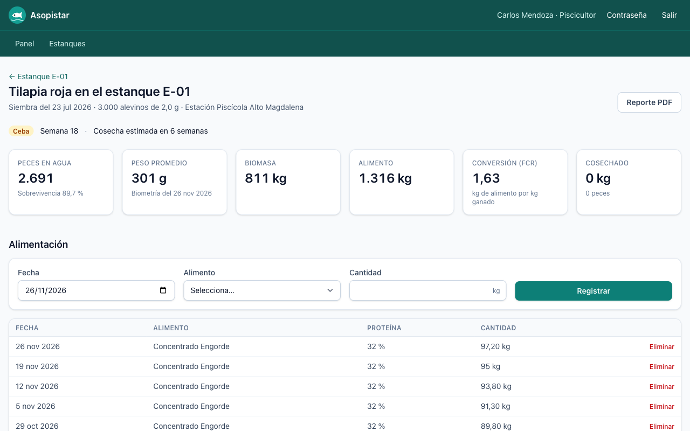
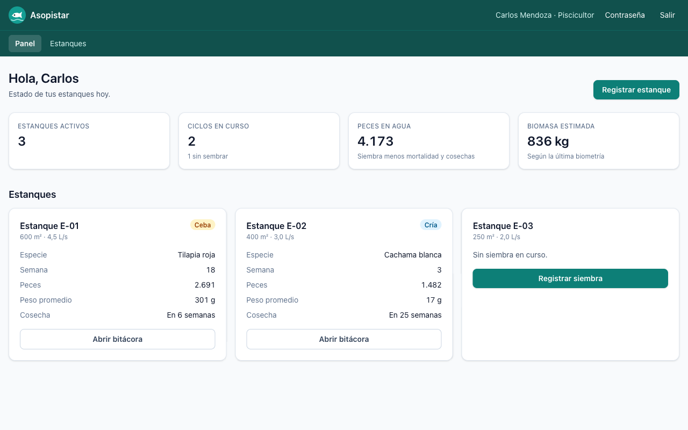
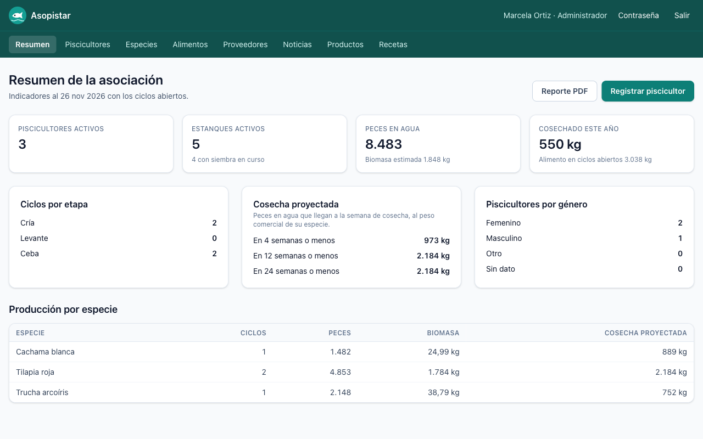
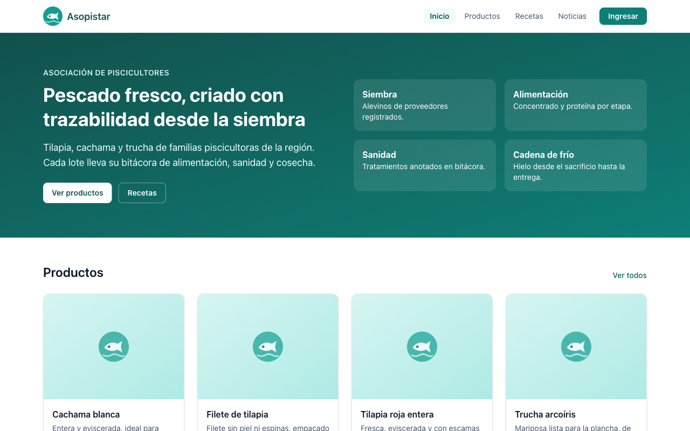
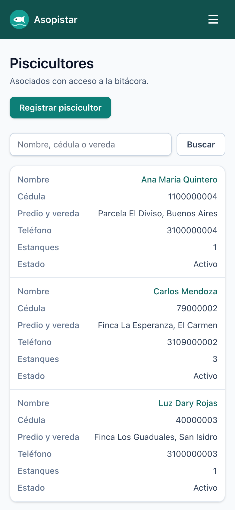
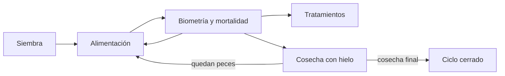

# ERP piscícola en Laravel para asociaciones de piscicultores

[](https://github.com/KevinAndrey96/laravel-asopistar-aquaculture-erp/actions/workflows/ci.yml)


**Bitácora digital y ERP para una asociación de piscicultores (Asopistar)**, hecha con Laravel 13, MariaDB y Tailwind CSS. Cada familia registra la siembra, la alimentación, las biometrías, la mortalidad, los tratamientos y la cosecha de sus estanques; la asociación ve en un solo tablero cuántos peces hay en agua, cuánta biomasa se proyecta cosechar y cómo rinde el alimento. Incluye un sitio público con productos, recetas y noticias.



## Qué hace

- **Estanques y ciclos productivos:** cada estanque tiene a lo sumo un ciclo abierto. La siembra registra especie, proveedor de alevinos, cantidad y peso inicial; el sistema calcula la semana del ciclo y la etapa (**cría, levante o ceba**) según el calendario de la especie.
- **Bitácora del ciclo:** alimentación (con la proteína del concentrado congelada en cada registro), biometrías con mortalidad, tratamientos sanitarios y cosechas con el **hielo de sacrificio, enfriamiento y transporte** para la cadena de frío.
- **Indicadores calculados:** peces en agua, sobrevivencia, peso promedio, biomasa estimada, **factor de conversión alimenticia (FCR)** y semanas que faltan para la cosecha.
- **Cierre del ciclo:** al cosechar todos los peces, al marcar la cosecha como final o con un cierre manual (lote perdido o trasladado). Un ciclo cerrado queda de solo lectura.
- **Tablero de la asociación:** piscicultores activos por género, estanques, ciclos por etapa, producción por especie, cosecha proyectada a 4, 12 y 24 semanas y alimento consumido.
- **Reportes PDF** del ciclo (para el piscicultor) y de la asociación (para la junta), generados con DomPDF.
- **Administración:** piscicultores, especies con su calendario productivo, marcas de alimento, proveedores con **NIT validado con el dígito de verificación de la DIAN**, noticias, productos y recetas con fotos.
- **Sitio público con SEO:** productos con precio en pesos, recetas con datos estructurados `Recipe`, noticias con `NewsArticle`, `sitemap.xml` y `robots.txt` dinámicos.
- **Diseño adaptable:** en el celular las tablas se convierten en tarjetas.

| Panel del piscicultor | Tablero de la asociación |
| :---: | :---: |
|  |  |

| Sitio público | Piscicultores en el celular |
| :---: | :---: |
|  |  |

## Roles y permisos

| Rol | Puede |
| :--- | :--- |
| **Piscicultor** | Registrar sus estanques, sembrar, llevar la bitácora de sus ciclos abiertos y descargar sus reportes. No ve los datos de otros asociados. |
| **Administrador** | Gestionar piscicultores, catálogos y contenido público, y consultar en modo lectura cualquier estanque o ciclo. No escribe en la bitácora de un piscicultor. |

No hay registro abierto: la asociación crea las cuentas. Las reglas viven en *policies* (`PondPolicy`, `CyclePolicy`) y en un middleware de rol; las rutas anidadas usan *scoped bindings*, de modo que un registro de otro ciclo responde 404.

## Seguridad

| Riesgo | Medida |
| :--- | :--- |
| Acceso a datos ajenos (IDOR) | Autorización por dueño en cada estanque, ciclo y registro; pruebas que cubren cada ruta con un usuario intruso. |
| Asignación masiva | Form Requests con reglas explícitas; el dueño del estanque y el rol nunca salen del formulario. |
| Datos inconsistentes | Fechas entre la siembra y hoy, mortalidad y cosecha limitadas a los peces que quedan, un solo ciclo abierto por estanque (con bloqueo de fila) y cierre no anterior al último registro. |
| Fuerza bruta | 5 intentos por correo e IP y 20 por minuto por IP; mensaje genérico ante credenciales erradas. |
| Cuentas desactivadas | No pueden ingresar y se cierra su sesión en la siguiente petición. |
| Subidas maliciosas | Solo imágenes JPG, PNG o WebP de máximo 4 MB, con nombre aleatorio en el disco público; la foto anterior se borra al reemplazarla. |
| XSS y clickjacking | Escape de Blade, Content Security Policy sin scripts en línea, `X-Frame-Options: DENY`, `nosniff`, `Referrer-Policy` y `Permissions-Policy`. |
| Caché de páginas privadas | `Cache-Control: no-store` en toda respuesta autenticada; sesión cifrada. |
| Secretos | Ninguna credencial en el repositorio: `APP_KEY`, la contraseña de la base de datos y la de las cuentas demo se generan con `make env`. |

## Arquitectura

```text
app/
├── Domain/
│   ├── Aquaculture/   Etapas, calendario por especie y métricas del ciclo (sin Eloquent)
│   └── Tax/           NIT colombiano con dígito de verificación
├── Actions/           Casos de uso transaccionales: sembrar, cosechar, cerrar ciclo
├── Policies/          Reglas de acceso por dueño y estado del ciclo
├── Reports/           Agregados del tablero y del PDF de la asociación
├── Http/
│   ├── Controllers/   Sitio público, piscicultor y administración
│   ├── Requests/      Validación con decimales en coma y mensajes en español
│   └── Middleware/    Rol y cabeceras de seguridad
├── Models/            Eloquent con relaciones, casts y agregados precargados
└── Support/           Formato colombiano de cifras y almacenamiento de fotos
```



Las métricas del ciclo (`CycleMetrics`) y el calendario de la especie (`SpeciesProfile`) son objetos de dominio puros, probados sin base de datos. El tablero precarga las sumas de alimento, mortalidad y cosecha con `withSum`, sin consultas N+1.

## Puesta en marcha local

Requisitos: Docker y `make`.

```bash
make up    # crea .env con secretos aleatorios, construye la imagen y levanta la app con MariaDB 11.8
make e2e   # prueba de humo contra el entorno levantado
```

Abre <http://localhost:8080>. El arranque carga una asociación demo con cuatro asociados y ciclos en todas las etapas:

| Cuenta | Rol |
| :--- | :--- |
| `admin@asopistar.test` | Administrador |
| `piscicultor@asopistar.test` | Piscicultor |

La contraseña de ambas es el valor de `DEMO_PASSWORD` en tu `.env` (`make env` la muestra al crearlo).

## Despliegue

La imagen `runtime` corre Apache como `www-data` en el puerto 8080, expone `/up` para el balanceador y en cada arranque aplica migraciones y catálogos base (especies, alimentos y proveedores). Variables principales:

| Variable | Obligatoria | Descripción |
| :--- | :---: | :--- |
| `APP_KEY` | Sí | Clave de cifrado de Laravel (`base64:` + 32 bytes). |
| `APP_URL` | Sí | URL pública; se usa en el sitemap y en las URL absolutas. |
| `DB_HOST`, `DB_DATABASE`, `DB_USERNAME`, `DB_PASSWORD` | Sí | Conexión a MariaDB o MySQL. |
| `SEED_DEMO` | No | `true` carga la asociación demo; déjalo en `false` en producción. |
| `APP_TRUST_PROXIES` | No | `true` solo detrás de un proxy que termine TLS. |
| `SESSION_SECURE_COOKIE` | No | `true` cuando el sitio se sirve por HTTPS. |
| `APP_TIMEZONE` | No | Zona horaria de los registros; por defecto `America/Bogota`. |

Las fotos se guardan en `storage/app/public`, montado como volumen en `docker-compose.yml`.

## Pruebas y calidad

```bash
make test    # PHPUnit dentro de la imagen de pruebas
make check   # Pint, Larastan nivel 8 y PHPUnit
```

- **92 pruebas** unitarias y de integración: calendario y métricas del ciclo, NIT de la DIAN, formato colombiano, ingreso y bloqueo, autorización por dueño en cada ruta, ciclo de vida completo (siembra, bitácora, cosechas parciales y final, cierre), reportes PDF, catálogos, fotos, sitio público y cabeceras de seguridad.
- **Prueba de extremo a extremo** en CI con Docker Compose y MariaDB real: sitio público, ingreso con token CSRF, bitácora, reporte PDF y bloqueo del área administrativa.
- CI en PHP 8.4 y 8.5; Dependabot para Composer, npm, Docker y GitHub Actions.

## Historia del proyecto

La primera versión (2022) fue una aplicación Laravel 8 hecha para la asociación junto con [marjuliam](https://github.com/marjuliam): registro de estanques, alimentación, biometrías y reportes sobre una plantilla de administración. En 2026 la reescribí desde cero en Laravel 13 con el ciclo productivo como eje, autorización por dueño, validación de datos de campo, indicadores calculados, pruebas automatizadas y despliegue en contenedores. La versión original queda en la etiqueta `v0.1-legacy` como referencia.

## Autor

**Kevin Andrey Herrera Silva**, desarrollador backend. [GitHub](https://github.com/KevinAndrey96)

## Licencia

Sin licencia de código abierto. El proyecto nació como trabajo para un cliente y se publica como muestra de portafolio: todos los derechos reservados.
