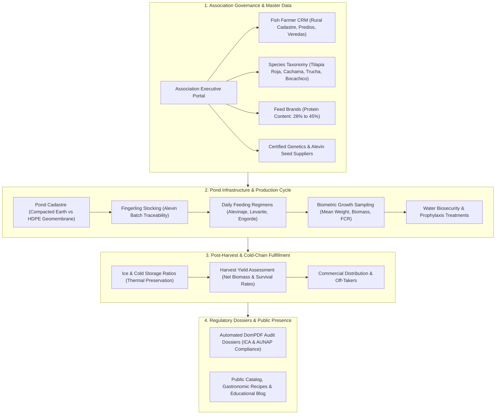

# asopistar-erp-platform: Enterprise Aquaculture & Fish Farming Management System

<div align="center">

[](https://laravel.com)
[](https://www.php.net/)
[](https://mariadb.org/)
[](https://www.docker.com/)
[](LICENSE)

<p align="center">
  <strong>Enterprise Aquaculture & Continental Fish Farming Management Platform (ERP). Engineered for fish farmer associations (Asociaciones de Piscicultores) to coordinate rural producers, track pond lifecycles, optimize feed conversion, monitor biometric growth, enforce cold-chain biosecurity, and record harvest yields.</strong>
</p>

</div>

---

## 📌 Executive Summary & Real-World Domain

In continental aquaculture, associations of small and mid-scale fish farmers (*Asociaciones de Piscicultores*) face significant operational challenges: decentralized record-keeping, unstandardized feeding regimens, disease vulnerability due to unmonitored water chemistry, and post-harvest biomass loss during road transit.

Originally engineered for the **Asociación de Piscicultores (Asopistar)** in Colombia, this platform transitions artisanal fish farming into a digitized, data-driven, and audit-compliant agricultural enterprise. The ERP unifies association governance with day-to-day farm operations across rural plots (*predios* and *veredas*), offering complete biological traceability from certified fingerling stocking (*siembra de alevinos*) through biometric growth sampling to cold-chain preservation and commercial harvest yields (*cosechas*).

---

## 🐟 Production Lifecycle & Architectural Pipeline

The platform enforces strict Role-Based Access Control (**Association Administrator** and **Fish Farmer / Producer**), coordinating every phase of the continental aquaculture supply chain:



---

## 🚀 Key Functional Modules

### 1. Producer CRM & Rural Pond Cadastre
- **Farmer Identity & Rural Georeferencing**: Catalogs associated producers with national tax identifiers, association membership codes, contact channels, and rural plot coordinates (*predios* and *veredas*).
- **Pond Infrastructure Modeling**: Registers physical pond parameters including surface area ($m^2$), water column volume ($m^3$), construction typology (compacted clay/earth vs high-density polyethylene HDPE geomembranes), aeration assets (paddle wheels, splash aerators), and current operational states.

### 2. Fingerling Stocking & Biological Seed Traceability
- **Genetics Provenance**: Records incoming alevin batches, supplier genetics certification, quantity stocked, and stocking density per cubic meter.
- **Taxonomic Multi-Species Support**: Built-in biological parameters for:
  - **Tilapia Roja** (*Oreochromis sp.*)
  - **Cachama Negra** (*Colossoma macropomum*)
  - **Trucha Arcoiris** (*Oncorhynchus mykiss*)
  - **Bocachico** (*Prochilodus magdalenae*)

### 3. Nutrition Optimization & Biometric Growth Tracking
- **Phased Nutrition Programs**: Logs daily feed rations segmented by production stage (*Alevinaje*, *Levante*, *Engorde*) and crude protein concentrations (28%, 32%, 38%, 45%).
- **Biometric Sampling**: Computes sample counts and gross weights to calculate mean individual fish weight, total pond biomass, average daily weight gain (ADG), and Feed Conversion Ratios (FCR).

### 4. Water Biosecurity & Prophylactic Health Records
- **Sanitary Treatments**: Logs preventive and corrective chemical/organic prophylaxis (agricultural lime, sodium chloride/sea salt baths, formalin, bio-remediation probiotics).
- **Physical-Chemical Logging**: Tracks dissolved oxygen, temperature, pH, and water transparency readings (Secchi disk depth).

### 5. Post-Harvest Cold Chain & Commercial Harvest Yields
- **Thermal Preservation Compliance**: Monitors ice-to-fish ratios during humane slaughter, initial chilling, and road dispatch to prevent spoilage and texture degradation.
- **Harvest Yield Analytics**: Aggregates final harvest metrics: gross harvested biomass (kg), total piece counts, average harvest weight, pond survival percentages, and commercial distribution channels.

### 6. Automated PDF Auditing & Regulatory Compliance
- **DomPDF Inspection Dossiers**: Generates automated, vectorized PDF inspection certificates per individual pond or consolidated association summaries formatted for agricultural audit agencies (ICA, AUNAP).

---

## 🛠️ Technology Stack & Engineering Specifications

| Layer | Component | Specification |
| :--- | :--- | :--- |
| **Backend Framework** | Laravel 8.x | MVC architecture, Eloquent ORM, Service Layer, Seeders |
| **Runtime** | PHP 8.1+ | Alpine Linux container, OPcache acceleration |
| **Web Server** | Nginx | Reverse proxy with FastCGI process manager |
| **Relational Database** | MariaDB 10.11 / MySQL 8.0 | InnoDB ACID transactions, foreign key constraints |
| **PDF Engine** | Barryvdh Laravel DomPDF | Vectorized PDF reports and regulatory dossiers |
| **Email Interception** | Mailpit | Local SMTP testbed and debugging interface |
| **Containerization** | Docker & Docker Compose | Multi-container automated orchestration |

---

## 📦 Containerized Quickstart (Docker Compose)

The repository provides a turnkey, multi-container Docker Compose stack for instant local evaluation.

### Prerequisites

- **Docker Desktop** (version 20.10+ / Compose v2).
- Ports `8094`, `8095`, `3312`, and `8026` available locally.

### Installation & Launch

```bash
# 1. Clone the repository
git clone https://github.com/KevinAndrey96/asopistar-erp-platform.git
cd asopistar-erp-platform

# 2. Start the containerized environment
docker compose up -d --build
```

The automated startup script will:
1. Initialize the **MariaDB 10.11** database container with health verification.
2. Build the **PHP 8.1 FPM + Nginx** application image.
3. Execute all database migrations (`php artisan migrate --force`).
4. Seed the database with a complete aquaculture operational dataset (`php artisan db:seed --force`).

---

## 🌐 Port Mapping & Services

| Service | Access URL | Port | Description |
| :--- | :--- | :---: | :--- |
| **Aquaculture ERP Web App** | [http://localhost:8094](http://localhost:8094) | `8094` | Main application and producer dashboard |
| **phpMyAdmin** | [http://localhost:8095](http://localhost:8095) | `8095` | Visual database manager (User: `root`, Pass: `***REMOVED***`) |
| **Mailpit Web UI** | [http://localhost:8026](http://localhost:8026) | `8026` | Local transactional email interceptor |
| **MariaDB Server** | `localhost:3312` | `3312` | Direct relational database connection |

---

## 🔑 Pre-Seeded Demo Credentials

The database is pre-seeded with full operational test accounts:

### 1. Association Administrator
- **URL**: [http://localhost:8094/login](http://localhost:8094/login)
- **Email**: `admin@asopistar.com`
- **Password**: `***REMOVED***`
- **Permissions**: Global association overview, producer catalog, species taxonomy, suppliers, feed brands, educational blogs, and recipes.

### 2. Piscicultor / Fish Farmer
- **URL**: [http://localhost:8094/login](http://localhost:8094/login)
- **Email**: `piscicultor@asopistar.com`
- **Password**: `***REMOVED***`
- **Permissions**: Producer dashboard for Hacienda La Esperanza (Ponds EST-01 and EST-02), stocking records, daily feeding logs, biometric weight sampling, sanitary treatments, cold chain records, and PDF dossier downloads.

---

## 📂 Repository Structure

```text
asopistar-erp-platform/
├── app/
│   ├── Http/Controllers/     # Controllers (Piscicultor, Pond, Alevin, Feeding, Harvest, etc.)
│   └── Models/               # Eloquent Models (Pond, Specie, Alevin, Feeding, Weight, etc.)
├── database/
│   ├── migrations/           # 20 relational database migrations
│   └── seeders/              # Comprehensive Aquaculture ERP database seeder
├── docker/
│   ├── nginx.conf            # Optimized Nginx virtual host
│   └── entrypoint.sh         # Automated startup, migration, and seeder runner
├── resources/
│   └── views/                # Blade views (Ponds, Reports, Biometry, Admin dashboards)
├── routes/
│   └── web.php               # Protected and public application web routes
├── docker-compose.yml        # Multi-container orchestration stack
├── Dockerfile                # Production-ready PHP 8.1 FPM + Nginx Alpine image
└── .env.example              # Sanitized configuration template
```

---

## 📄 License

This software is open-sourced under the [MIT License](LICENSE).

---

## 👨‍💻 Author

**Kevin Andrey Herrera Silva**  
*Senior Backend Engineer & Software Architect*  
Bogotá, Colombia  
- [GitHub](https://github.com/KevinAndrey96)  
- [LinkedIn](https://www.linkedin.com/in/kevinandrey96/)  
