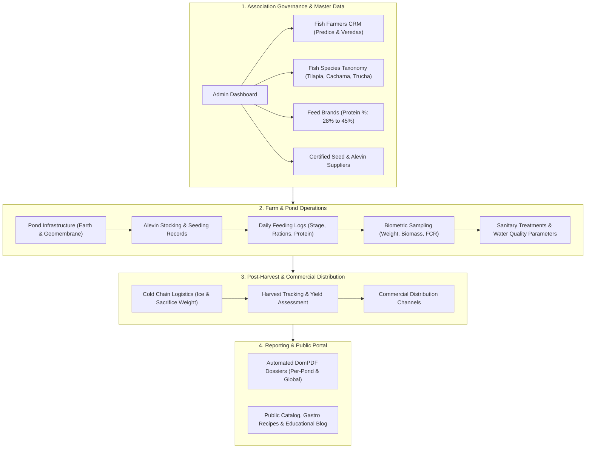

# Asopistar: Enterprise Aquaculture & Fish Farming ERP Platform

[](https://laravel.com)
[](https://www.php.net/)
[](https://mariadb.org/)
[](https://www.docker.com/)
[](LICENSE)

An enterprise-ready **Aquaculture & Fish Farming ERP Management Platform** engineered in **Laravel 8**, **PHP 8.1+**, and **MySQL/MariaDB**. Originally developed for the **Asociación de Piscicultores (Asopistar)**, this platform digitizes and centralizes the operational lifecycle of continental aquaculture farms: fish farmer profiling, pond infrastructure, alevin stocking, daily ration feeding, biometric growth sampling, water quality and health treatments, post-harvest cold chain logistics, and automated PDF certification reports.

---

## 🐟 System Architecture & Core Modules

The platform is designed around dual role-based access control (**Administrator** and **Piscicultor / Producer**), managing the end-to-end aquaculture production cycle:



---

## 🚀 Key Functional Capabilities

### 1. Producer CRM & Pond Cadastre
- **Farmer Identity & Rural Location**: Profiles aquaculture producers with unique association codes, tax IDs, contact channels, and rural plot designations (*predios* and *veredas*).
- **Pond Infrastructure Modeling**: Manages physical pond dimensions (surface area in $m^2$, water volume in $m^3$), construction type (compacted earth vs high-density polyethylene HDPE geomembranes), aeration equipment (paddle wheels, splash aerators), and lifecycle states.

### 2. Alevin Stocking & Seeding
- **Seed Provenance Traceability**: Logs incoming alevin batches, supplier genetics certification, quantity stocked, and stocking density calculations.
- **Species Lifecycle Taxonomy**: Configurable developmental thresholds for **Tilapia Roja** (*Oreochromis sp.*), **Cachama Negra** (*Colossoma macropomum*), **Trucha Arcoiris** (*Oncorhynchus mykiss*), and **Bocachico** (*Prochilodus magdalenae*).

### 3. Feeding Optimization & Growth Biometry
- **Nutrition Stages**: Categorizes daily feeding by production phase (*Alevinaje*, *Levante*, *Engorde*) and protein requirements (28% to 45%).
- **Biometric Weight Sampling**: Records periodic sample counts and total weight to calculate mean individual weight, total pond biomass, and Feed Conversion Ratios (FCR).

### 4. Health Biosecurity & Water Quality
- **Sanitary Treatments**: Logs preventive and corrective prophylaxis (agricultural lime, sea salt treatments, formalin, probiotics).
- **Physical-Chemical Logging**: Tracks dissolved oxygen, temperature, pH, and water transparency (Secchi disk readings).

### 5. Post-Harvest Cold Chain & Commercialization
- **Ice & Cold Storage Ratios**: Monitors post-harvest temperature control, logging ice ratios per kilogram during slaughter, initial chilling, and road transport.
- **Harvest Execution**: Tracks final harvest yields, piece counts, mean harvest weights, and destinations (wholesale fish markets, restaurants, processing facilities).

### 6. Automated PDF Generation
- **Executive Dossiers**: Integrates **DomPDF** to compile formal exportable PDF audit dossiers per pond or aggregate association summaries for governmental agricultural authorities.

---

## 🛠️ Technology Stack

| Layer | Component | Specification |
| :--- | :--- | :--- |
| **Backend Framework** | Laravel 8.x | Clean MVC, Service Providers, Eloquent ORM |
| **Runtime** | PHP 8.1+ | Alpine Linux container, OPcache enabled |
| **Web Server** | Nginx | Reverse proxy with FastCGI process manager |
| **Database** | MariaDB 10.11 / MySQL 8.0 | ACID relational engine, foreign key integrity |
| **PDF Engine** | Barryvdh Laravel DomPDF | Vectorized PDF reporting and dossiers |
| **Email Testing** | Mailpit | Local SMTP interception and visual mailbox |
| **Containerization** | Docker & Docker Compose | Multi-container automated orchestration |

---

## 📦 Containerized Quickstart (Docker Compose)

The repository provides a turnkey, multi-container Docker Compose stack configured for instant local evaluation.

### Prerrequisitos

- **Docker Desktop** (version 20.10+ / Compose v2).
- Ports `8094`, `8095`, `3312`, and `8026` available locally.

### Installation & Launch

```bash
# 1. Clone the repository
git clone https://github.com/KevinAndrey96/asopistar.git
cd asopistar

# 2. Start the containerized environment
docker compose up -d --build
```

The startup script will automatically:
1. Initialize the **MariaDB 10.11** database container and wait for the health check.
2. Build the **PHP 8.1 FPM + Nginx** application image.
3. Execute database schema migrations (`php artisan migrate --force`).
4. Seed the database with realistic aquaculture production records (`php artisan db:seed --force`).

---

## 🌐 Port Mapping & Services

| Service | Access URL | Port | Description |
| :--- | :--- | :---: | :--- |
| **Asopistar Web App** | [http://localhost:8094](http://localhost:8094) | `8094` | Main application and producer dashboard |
| **phpMyAdmin** | [http://localhost:8095](http://localhost:8095) | `8095` | Visual database manager (User: `root`, Pass: `***REMOVED***`) |
| **Mailpit Web UI** | [http://localhost:8026](http://localhost:8026) | `8026` | Local transactional email interceptor |
| **MariaDB Server** | `localhost:3312` | `3312` | Direct MySQL/MariaDB database connection |

---

## 🔑 Pre-Seeded Demo Credentials

The database is pre-seeded with complete demo accounts and operational records:

### 1. Association Administrator
- **URL**: [http://localhost:8094/login](http://localhost:8094/login)
- **Email**: `admin@asopistar.com`
- **Password**: `***REMOVED***`
- **Scope**: Full access to association dashboard, global reports, producer catalog, species taxonomy, suppliers, feed brands, blogs, and recipes.

### 2. Piscicultor / Fish Farmer
- **URL**: [http://localhost:8094/login](http://localhost:8094/login)
- **Email**: `piscicultor@asopistar.com`
- **Password**: `***REMOVED***`
- **Scope**: Producer dashboard for Hacienda La Esperanza: ponds EST-01 and EST-02, alevin stocking, daily feeding logs, biomass growth weights, health logs, ice cold-chain records, and pond PDF downloads.

---

## 📂 Repository Structure

```text
asopistar/
├── app/
│   ├── Http/Controllers/     # Controllers (Piscicultor, Pond, Alevin, Feeding, Harvest, etc.)
│   └── Models/               # Eloquent Models (Pond, Specie, Alevin, Feeding, Weight, etc.)
├── database/
│   ├── migrations/           # 20 relational database migrations
│   └── seeders/              # Comprehensive Aquaculture ERP database seeder
├── docker/
│   ├── nginx.conf            # Optimized Nginx virtual host
│   └── entrypoint.sh         # Automated startup, migration, and seeder runner
├── resources/
│   └── views/                # Blade views (Ponds, Reports, Biometry, Admin dashboards)
├── routes/
│   └── web.php               # Protected and public application web routes
├── docker-compose.yml        # Multi-container orchestration stack
├── Dockerfile                # Production-ready PHP 8.1 FPM + Nginx Alpine image
└── .env.example              # Sanitized configuration template
```

---

## 📄 License

This software is open-sourced under the [MIT License](LICENSE).
